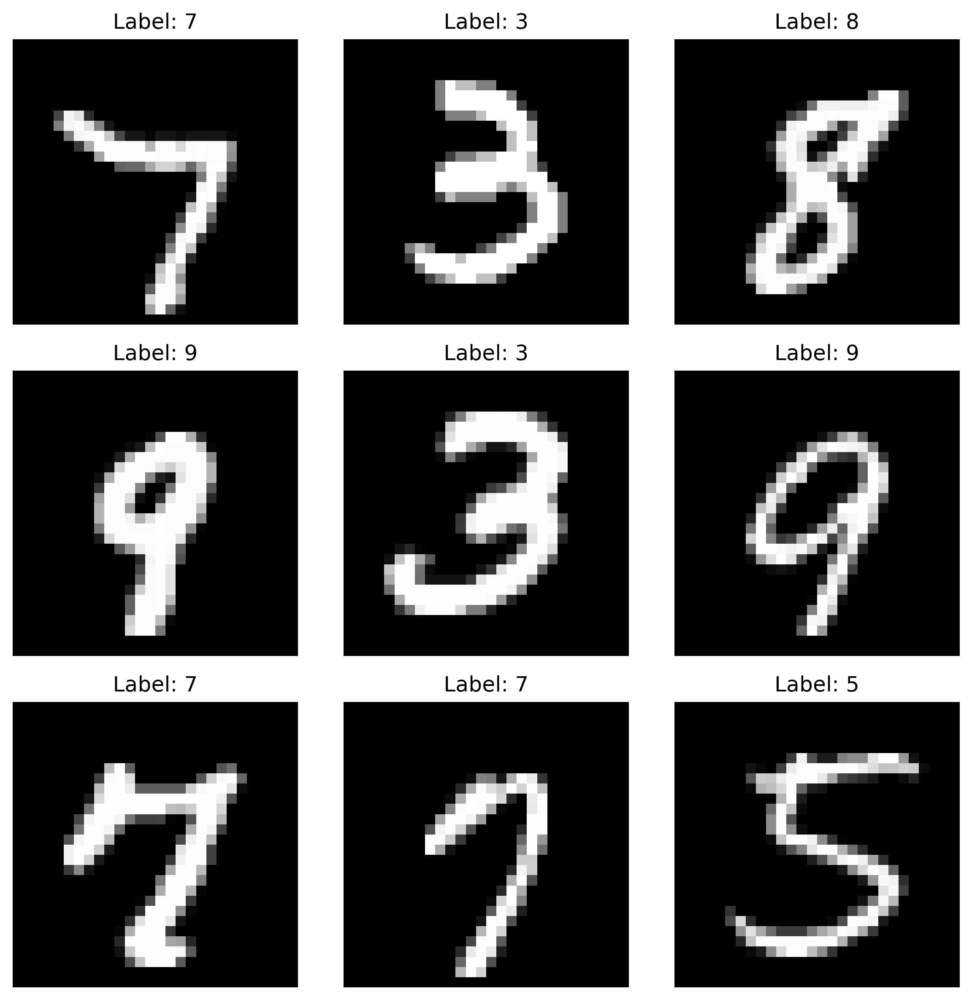
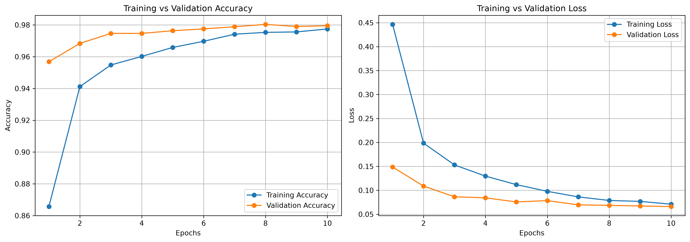
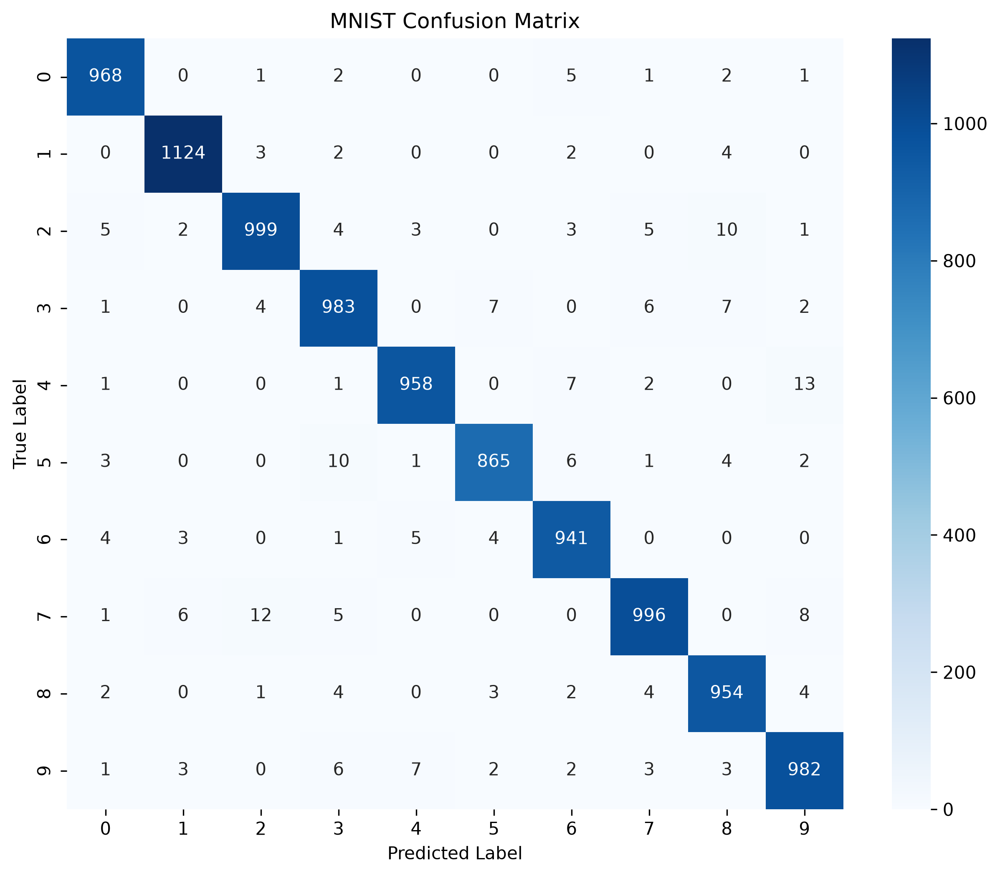
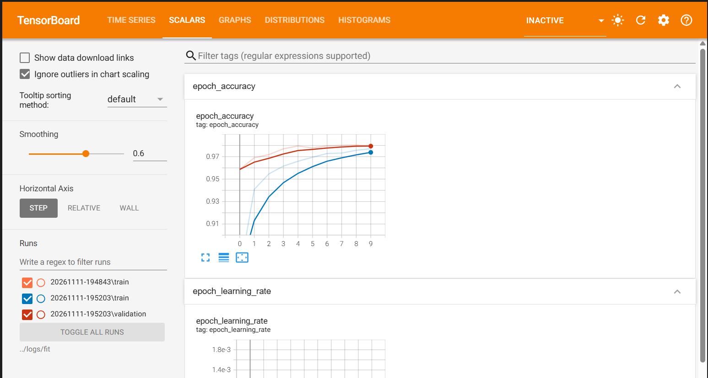
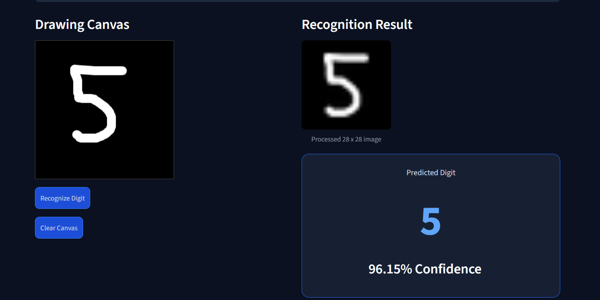

# DigitVision: MNIST Handwritten Digit Recognition

## 1. Project Overview

DigitVision is a handwritten digit recognition application developed using an Artificial Neural Network (ANN). The project uses the MNIST dataset to train a deep learning model that identifies handwritten digits from 0 to 9.

The application provides an interactive interface built with Streamlit, allowing users to draw digits on a canvas and receive predictions with corresponding confidence scores.

It also includes a prediction rejection mechanism designed to identify uncertain inputs rather than always returning a digit.

## 2. Project Objectives

- Develop an Artificial Neural Network for handwritten digit classification.
- Understand the process of preparing image data for deep learning.
- Train and evaluate a neural network using the MNIST dataset.
- Visualize model performance using accuracy, loss, and a confusion matrix.
- Build an interactive application for real-time digit recognition.
- Explore how prediction confidence can help identify uncertain inputs.

## 3. Dataset

The project uses the **MNIST handwritten digit dataset**, which contains:

- 60,000 training images.
- 10,000 testing images.
- 10 digit classes (0–9).
- Grayscale images measuring 28 × 28 pixels.

The dataset is loaded directly through TensorFlow Keras:

```python
from tensorflow.keras.datasets import mnist

(X_train, y_train), (X_test, y_test) = mnist.load_data()
```

### Sample Dataset Images



## 4. Data Preprocessing

The following preprocessing steps were performed:

1. Loaded the MNIST training and testing datasets.
2. Normalized pixel values from the range 0–255 to 0–1.
3. Converted digit labels into categorical representations using one-hot encoding.
4. Prepared the data for input into the neural network.

## 5. Model Architecture

The project uses a Sequential Artificial Neural Network with the following architecture:

| Layer | Configuration |
|---|---|
| Input | 28 × 28 grayscale image |
| Flatten | Converts image into a one-dimensional vector |
| Dense | 128 neurons, ReLU activation |
| Dropout | 30% dropout rate |
| Dense | 64 neurons, ReLU activation |
| Output | 10 neurons, Softmax activation |

### Model Compilation

- Optimizer: Adam
- Loss function: Categorical Crossentropy
- Evaluation metric: Accuracy
- Batch size: 128
- Maximum training epochs: 10
- Validation split: 10%

Early Stopping was implemented to monitor validation loss and restore the best model weights when training stopped.

TensorBoard was also used to monitor training performance.

## 6. Model Training and Performance

The model achieved the following results on the MNIST test dataset:

| Metric | Result |
|---|---:|
| Test Accuracy | 97.65% |
| Test Loss | 0.0788 |
| Training Accuracy | 97.71% |
| Validation Accuracy | 97.95% |

### Training History

The following graphs illustrate the changes in training and validation accuracy and loss across epochs.



### Confusion Matrix

The confusion matrix provides an overview of correctly and incorrectly classified digits across the ten classes.



### TensorBoard Monitoring

TensorBoard was used to visualize training and validation metrics.



## 7. DigitVision Application

The trained model was integrated into an interactive Streamlit application.

### Application Features

- **Dashboard:** Provides an overview of the project and model performance.
- **Digit Recognition:** Allows users to draw handwritten digits and receive predictions.
- **Model Performance:** Displays evaluation metrics and model architecture.
- **About:** Provides information about the application and its development.

### Application Dashboard


### Handwritten Digit Prediction

Users can draw a digit on the canvas and submit it for classification. The application displays the predicted digit and its confidence score.



### Prediction Rejection

The application uses confidence and prediction-margin thresholds to reject uncertain inputs.

If the prediction does not meet the configured thresholds, the application displays a message indicating that it cannot confidently recognize the input as a digit.

This helps reduce unreliable predictions, although it does not guarantee that letters or other non-digit drawings will always be rejected.

## 8. Technologies Used

- Python
- TensorFlow
- Keras
- NumPy
- Pandas
- Matplotlib
- Seaborn
- Scikit-learn
- Streamlit
- Pillow
- TensorBoard
- Streamlit Drawable Canvas

## 9. Project Structure

```text
mnist-ann-handwritten-digit-classification/
│
├── app.py
├── README.md
├── requirements.txt
│
├── images/
│   ├── mnist_samples.png
│   ├── training_history.png
│   ├── confusion_matrix.png
│   ├── tensorboard_dashboard.png
│   ├── digitvision_dashboard.png
│   └── digit_recognition.png
│
├── logs/
│   └── fit/
│
├── models/
│   └── mnist_ann_model.keras
│
└── notebooks/
    └── mnist_ann_classification.ipynb
```

## 10. Installation and Setup

### Prerequisites

- Python 3.12
- Git
- Visual Studio Code (recommended)

### Step 1: Clone the Repository

```bash
git clone https://github.com/sangvivy/mnist-ann-handwritten-digit-classification.git
```

Navigate into the project directory:

```bash
cd mnist-ann-handwritten-digit-classification
```

### Step 2: Create a Virtual Environment

```bash
python -m venv .venv
```

### Step 3: Install Dependencies

Activate your virtual environment and run:

```bash
pip install -r requirements.txt
```

### Step 4: Run the Application

```bash
streamlit run app.py
```

The application will open in your browser.

## 11. Limitations

- The model is trained specifically on the MNIST handwritten digit dataset.
- Its performance may vary when presented with handwriting styles that differ significantly from the training data.
- The prediction rejection mechanism relies on confidence thresholds and does not provide guaranteed non-digit detection.
- The application is designed for single-digit recognition rather than full handwritten text recognition.

## 12. Future Improvements

- Explore convolutional neural networks (CNNs) for image classification.
- Improve the detection of non-digit inputs.
- Expand the application to recognize multiple handwritten digits.
- Evaluate the model using handwriting samples from different sources.
- Explore model deployment and accessibility improvements.

## 13. Author

Developed as a practical deep learning project to explore Artificial Neural Networks, image classification, model evaluation, and interactive machine learning applications.

---

**Project:** DigitVision – MNIST Handwritten Digit Recognition  
**Model:** Artificial Neural Network (ANN)  
**Framework:** TensorFlow/Keras  
**Application:** Streamlit